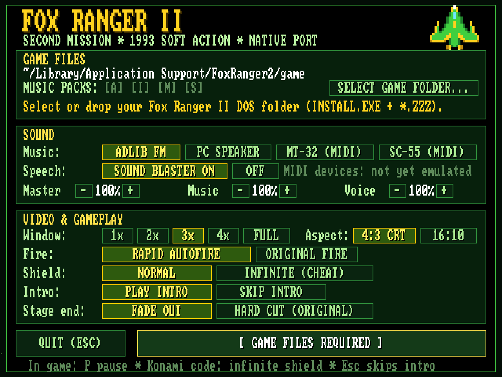

# Fox Ranger II: Second Mission — native port

A static recompilation of **Fox Ranger II: Second Mission** (Soft Action, 1993), the Korean MS-DOS
vertical shooter, into native C with an English translation. The original program chain
(`FR2.EXE` → intro, title, stages, cutscenes) runs as recompiled code on an SDL2 runtime with
Nuked-OPL3 FM music and Sound Blaster speech.

<p align="center"></p>

No original game files are included in this repository or its releases: no executables, graphics,
sound, music or Korean script. It contains the recompiled code (`gen/`), the runtime and tools, and
the English translation; the game data comes from your own copy.

## Playing

You need the original DOS release: the installer folder with `INSTALL.EXE` and the `*.ZZZ`
archives (an already installed copy works too). No game data ships with this project.

1. Start the game: **FoxRanger2.app** (macOS), **FoxRanger2.exe** (Windows, keep `SDL2.dll` next to
   it) or `./foxranger2` (Linux, needs SDL2: `sudo apt install libsdl2-2.0-0`).
2. In the launcher, click **SELECT GAME FOLDER...** and pick the DOS folder, or drop the folder on the
   launcher window. It is unpacked once into your user folder:
   `~/Library/Application Support/FoxRanger2/game` (macOS), `%APPDATA%\FoxRanger2\game` (Windows),
   `~/.local/share/foxranger2/game` (Linux).
3. Choose your options and press **LAUNCH MISSION**.

| Key | Action |
|---|---|
| Arrows | move |
| Ctrl / D | fire |
| Alt / C | bomb |
| P | pause (in a stage) |
| Esc / Space | skip the intro |
| ↑↑↓↓←→←→ B A | infinite shield (any screen) |

Launcher options: AdLib FM or PC-speaker music, Sound Blaster speech on/off, volumes, window
scale / fullscreen / 4:3, rapid autofire, infinite shield, skip intro, and a fade-out when a stage
ends (the original cuts straight to the next part). The original also supports Roland MT-32 and
Sound Canvas (SC-55) music over MPU-401 MIDI; those packs are imported but MIDI output is not
emulated yet.

## Building

Requires CMake ≥ 3.16, a C11 compiler and SDL2.

```sh
cmake -B build -DCMAKE_BUILD_TYPE=Release
cmake --build build          # build/foxrt2, and build/FoxRanger2.app on macOS
```

Release packages for all three systems (Windows and Linux are cross-compiled with
[Zig](https://ziglang.org), `brew install zig`):

```sh
SDL2_MINGW=<SDL2-devel-2.x-mingw>/x86_64-w64-mingw32 \
SDL2_LINUX_CMAKE=<dir with an sdl2-config.cmake for x86_64 Linux> \
tools/package_fr2.sh                 # -> dist/FoxRanger2-<ver>-{macOS,windows-x64,linux-x64}
```

`build/foxrt2 --help` lists the developer options (`--run st2 a v W` to start a stage,
`--headless --keys ... --shots ...` for scripted runs, `--no-launcher --game DIR`).

Tests that need the original game files:

```sh
build/test_pklite work/extracted work/pristine ST1.EXE ST2.EXE ...      # native unpacker
HOME=/tmp/scratch build/test_fr2_import /path/to/FR2-DOS-folder        # launcher import
build/test_zip /path/to/FR2-DOS-folder/2.ZZZ /tmp/out                 # archive reader (diff with unzip)
```

## Notes

- The installer archives (`*.ZZZ`) are PKZIP 1.x; `src/zipread.c` reads them (stored, shrunk,
  imploded). The programs are PKLITE 1.12 packed, most with a second EXEPACK layer; `src/pklite.c`
  unpacks them. Both run during import, so no external tools are needed.
- Fox Ranger 1 (`FoxRanger.app`, target `foxrt`) lives in the same tree and is separate.
